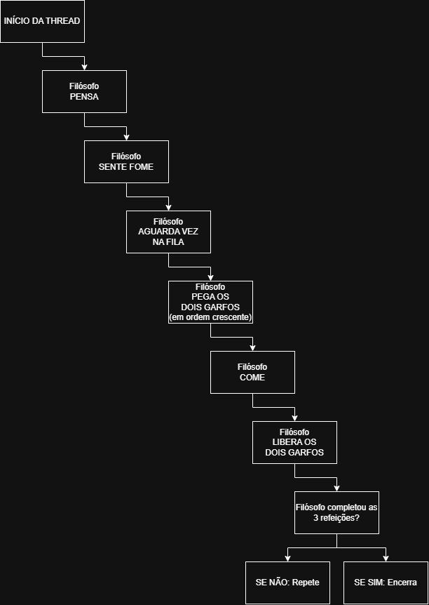

# TDE 2: Programação Concorrente

**Disciplina:** Performance em Sistemas Ciberfísicos  
**Linguagem:** Python 3.10+

## Vídeo de apresentação: https://youtu.be/wfkwVkEr9Vg

## Integrantes
- **Bárbara:** Jantar dos Filósofos.
- **Bruno:** testes, progresso e justiça (Parte 1).
- **Julia:** contador concorrente e semáforos.
- **Ícaro:** deadlock com dois locks.

## 1: JANTAR DOS FILÓSOFOS

### Objetivo e implementação
Simular cinco filósofos compartilhando cinco garfos, demonstrando problemas de concorrência e formas de evitar deadlock.
**Versão ingênua:** cada filósofo pega um garfo e aguarda o segundo. Uma barreira sincroniza as threads para reproduzir o impasse, impedindo que os filósofos avancem.
**Versão corrigida:** os garfos são adquiridos em ordem crescente de índice, eliminando a condição de espera circular, uma das quatro condições de Coffman. Um mecanismo de senhas organiza o atendimento dos pedidos, contribuindo para a justiça entre os filósofos.

### Resultados
A versão ingênua reproduziu o deadlock. Na versão corrigida, as 11 execuções foram concluídas, com três refeições por filósofo em cada uma e sem inanição observada.
Os logs completos e a análise dos resultados estão disponíveis em `evidencias/filosofos.txt`.

### Fluxograma


### Como executar
No terminal, a partir da raiz do repositório:
`python 1-filosofos/filosofos.py`
Selecione:
- `1` para a versão ingênua.
- `2` para a versão corrigida.

### Testes (progresso, justiça e inanição)
`python 1-filosofos/testes-filosofos.py`

O script roda o `filosofos.py` em subprocesso e confere a saída: na versão ingênua, os 5 filósofos ficam com um garfo esperando o segundo e o deadlock é detectado; na versão corrigida (10 rodadas), cada filósofo come 3 vezes e todos terminam. Também verifica que o `Lock` só deixa uma thread segurar o garfo por vez.
Resultado: todos os testes passaram, 150 refeições conferidas, nenhum deadlock na versão corrigida e nenhum filósofo sem comer. A diferença de refeições entre o filósofo que mais comeu e o que menos comeu ficou em no máximo 1 durante as execuções, então nenhum foi ultrapassado repetidamente. Isso é evidência das execuções feitas, não uma prova de justiça para qualquer execução.
Saída completa em `evidencias/testes-filosofos.txt`.

## 2: CONTADOR CONCORRENTE E SEMÁFOROS

### Objetivo e implementação
Demonstrar uma condição de corrida por meio de incrementos concorrentes em um contador compartilhado e comparar o comportamento das versões com e sem sincronização.
Foram implementadas duas versões em Python utilizando `threading.Thread`:
* **Sem semáforo:** as threads incrementam diretamente o contador compartilhado, sem proteção da seção crítica. Para aumentar a possibilidade de ocorrência da condição de corrida, foi utilizado `time.sleep(0)` ocasionalmente, cedendo a execução entre a leitura e a atualização do contador.
* **Com semáforo:** utiliza `threading.Semaphore(1)` para proteger a operação de incremento. Como existe apenas uma permissão, somente uma thread por vez pode executar a seção crítica.

### Parâmetros do experimento
* **Threads:** 8
* **Incrementos por thread:** 200.000
* **Repetições por versão:** 3
* **Valor esperado:** 1.600.000 incrementos

### Resultados
| Versão | Rodada | Valor esperado | Valor obtido | Tempo (s) |
| :--- | :---: | :---: | :---: | :---: |
| Sem semáforo | 1 | 1.600.000 | 1.600.000 | 0,1070 |
| Sem semáforo | 2 | 1.600.000 | 1.400.000 | 0,1075 |
| Sem semáforo | 3 | 1.600.000 |   851.000 | 0,1087 |
| Com semáforo | 1 | 1.600.000 | 1.600.000 | 1,2021 |
| Com semáforo | 2 | 1.600.000 | 1.600.000 | 1,2059 |
| Com semáforo | 3 | 1.600.000 | 1.600.000 | 1,1707 |

### Análise dos resultados
* **Condição de corrida:** na versão sem sincronização, duas das três execuções apresentaram perda de incrementos. Isso acontece porque diferentes threads podem ler o mesmo valor do contador antes de atualizá-lo. Quando uma delas grava o resultado, pode sobrescrever a atualização realizada por outra thread. Na segunda execução, o valor esperado foi alcançado, demonstrando que a ocorrência e a intensidade da perda podem variar entre execuções.
* **Exclusão mútua:** na versão protegida, todas as execuções alcançaram o valor esperado. O semáforo binário permite que apenas uma thread por vez acesse a seção crítica, evitando atualizações concorrentes que poderiam causar perda de incrementos.
* **Throughput e desempenho:** o tempo médio foi de aproximadamente `0,1059` segundos sem semáforo e `1,2001` segundos com semáforo. A versão protegida levou cerca de 11,3 vezes mais tempo. Esse aumento ocorre devido ao custo da sincronização e à espera das threads pela liberação do semáforo. Apesar de apresentar menor throughput neste experimento, a versão sincronizada garante a consistência do resultado.
* **Justiça (fairness):** o semáforo binário utilizado garante exclusão mútua, mas não garante que as threads sejam atendidas na ordem em que solicitaram acesso. Em Python, `threading.Semaphore` não oferece garantia de atendimento FIFO. Portanto, a ausência de perda de incrementos não significa necessariamente que exista justiça na distribuição do acesso entre as threads.
* **Visibilidade e ordenação:** os mecanismos de sincronização de threads do Python coordenam o acesso aos dados compartilhados e a execução da seção crítica. A aquisição e a liberação do semáforo organizam o acesso concorrente ao contador. Diferentemente do Java, que documenta explicitamente a relação *happens-before* entre `release` e `acquire`, a explicação em Python deve considerar os mecanismos de sincronização disponibilizados pelo runtime. O GIL não substitui a necessidade de proteger operações compostas sobre dados compartilhados.

### Como executar
No terminal, a partir da raiz do repositório, execute o comando:
```bash
python 2-semaforo/contador.py
```
O programa executa automaticamente as três rodadas sem semáforo e as três rodadas com semáforo, exibindo o valor esperado, o valor obtido e o tempo de execução de cada uma.
Os registros completos do experimento estão disponíveis em `evidencias/semaforo.txt`.

## 3: DEADLOCK COM DOIS LOCKS

### Objetivo e implementação
Demonstrar um deadlock com duas threads e dois locks compartilhados, utilizando `threading.Thread` e `threading.Lock` em Python.

**Versão com deadlock:** T1 adquire A e depois tenta adquirir B, enquanto T2 adquire B e depois tenta adquirir A. A pausa `time.sleep(0.05)` entre as aquisições aumenta a chance de cada thread adquirir o primeiro lock antes de solicitar o segundo. Quando isso acontece, cada uma mantém um lock e espera pelo outro, impedindo o progresso das duas.

**Versão corrigida:** ambas as threads adquirem os locks na mesma ordem global: A antes de B. Quem espera por A ainda não possui B, impedindo a formação de espera circular. As aquisições são feitas com `acquire()` e, após a conclusão, os locks são liberados com `release()` na ordem inversa: B antes de A.

### Condições de Coffman
Na versão com deadlock, as quatro condições aparecem simultaneamente:

- **Exclusão mútua:** cada lock só pode estar adquirido por uma thread por vez.
- **Manter e esperar:** cada thread mantém um lock enquanto aguarda o outro.
- **Não preempção:** o protocolo não retira à força os locks adquiridos pelas threads.
- **Espera circular:** T1 aguarda B, mantido por T2, enquanto T2 aguarda A, mantido por T1.

### Resultados
Na execução registrada, a primeira versão apresentou os logs de espera cruzada e o diagnóstico de deadlock, sem que nenhuma thread concluísse. Na versão corrigida, T1 e T2 adquiriram A antes de B e concluíram normalmente, eliminando a condição de espera circular.

O timeout dos dois `join(timeout=5)` permite exibir o diagnóstico e retornar ao menu após aproximadamente 10 segundos no cenário de impasse. As threads continuam bloqueadas até o encerramento do processo; a opção corrigida inicia uma nova execução com novos locks e novas threads.

Os registros das duas versões estão disponíveis em [evidencias/deadlock.txt](evidencias/deadlock.txt).

### Como executar
No terminal, a partir da raiz do repositório:

```bash
python 3-deadlock/deadlock.py
```

Selecione:

- `1` para demonstrar o deadlock.
- `2` para demonstrar a correção por hierarquia de locks.
- `3` para sair.
