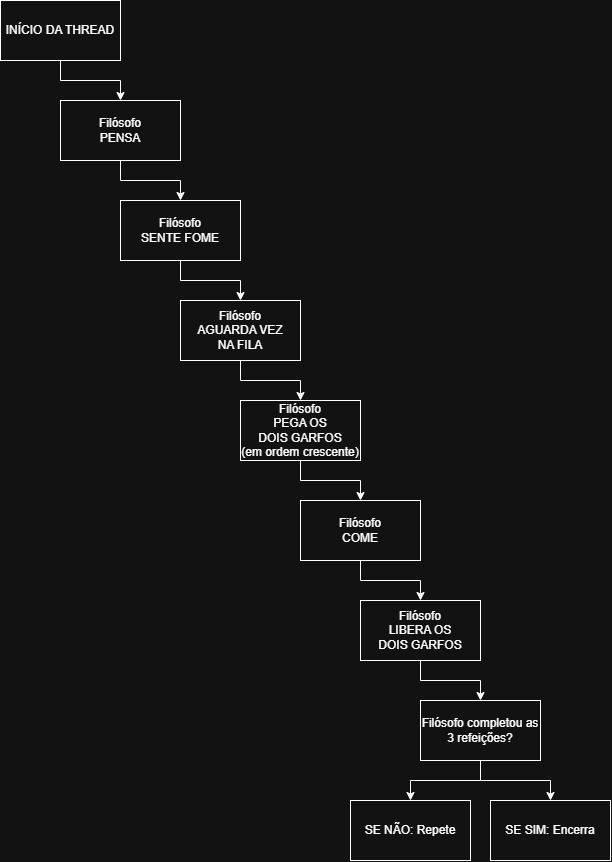

# TDE 2: Programação Concorrente

**Disciplina:** Performance em Sistemas Ciberfísicos  
**Linguagem:** Python 3.10+

## Vídeo de apresentação: >>*[INSERIR LINK AQUI]*<<

## Integrantes
- **Bárbara:** Jantar dos Filósofos.
- **Bruno:** testes, progresso e justiça (Parte 1).
- **Julia:** contador concorrente e semáforos.
- **Ícaro:** deadlock com dois locks.

## 1: JANTAR DOS FILÓSOFOS

### Objetivo e implementação
Simular cinco filósofos compartilhando cinco garfos, demonstrando problemas de concorrência e formas de evitar deadlock.
**Versão ingênua:** cada filósofo pega um garfo e aguarda o segundo. Uma barreira sincroniza as threads para reproduzir o impasse, impedindo que os filósofos avancem.
**Versão corrigida:** os garfos são adquiridos em ordem crescente de índice, eliminando a condição de espera circular, uma das quatro condições de Coffman. Um mecanismo de senhas organiza o atendimento dos pedidos, contribuindo para a justiça entre os filósofos.

### Resultados
A versão ingênua reproduziu o deadlock. Na versão corrigida, as 11 execuções foram concluídas, com três refeições por filósofo em cada uma e sem inanição observada.
Os logs completos e a análise dos resultados estão disponíveis em `evidencias/filosofos.txt`.

### Fluxograma

### Como executar
No terminal, a partir da raiz do repositório:
`python 1-filosofos/filosofos.py`
Selecione:
- `1` para a versão ingênua.
- `2` para a versão corrigida.

### Testes (progresso, justiça e inanição)
`python 1-filosofos/testes-filosofos.py`

O script roda o `filosofos.py` em subprocesso e confere a saída: na versão ingênua, os 5 filósofos ficam com um garfo esperando o segundo e o deadlock é detectado; na versão corrigida (10 rodadas), cada filósofo come 3 vezes e todos terminam. Também verifica que o `Lock` só deixa uma thread segurar o garfo por vez.
Resultado: todos os testes passaram, 150 refeições conferidas, nenhum deadlock na versão corrigida e nenhum filósofo sem comer. A diferença de refeições entre o filósofo que mais comeu e o que menos comeu ficou em no máximo 1 durante as execuções, então nenhum foi ultrapassado repetidamente. Isso é evidência das execuções feitas, não uma prova de justiça para qualquer execução.
Saída completa em `evidencias/testes-filosofos.txt`.

## 2: CONTADOR CONCORRENTE E SEMÁFOROS

*A completar*

## 3: DEADLOCK COM DOIS LOCKS

*A completar*
